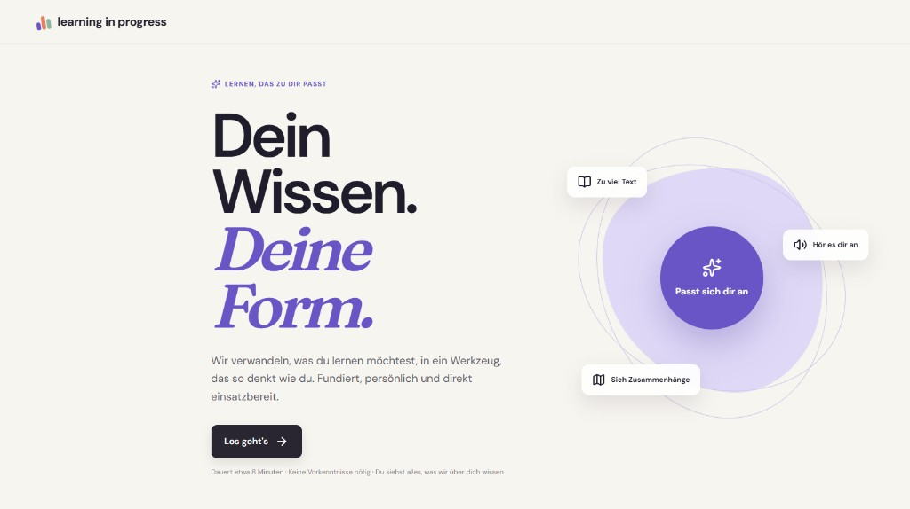

# learning-in-progress

**Learning in Progress** passt Lernmaterial an die Bedürfnisse und Lernziele
einer Person an, ohne den fachlichen Inhalt zu verändern.

## Demo

Die Anwendung ist unter
[binnendifferenzierung.online](https://binnendifferenzierung.online/) verfügbar.

## Grundidee

### Problem

Lernmaterial liegt meist in einem festen Format vor. Dieses Format kann für
Lernende, beispielsweise mit Legasthenie oder ADHS, eine zusätzliche Barriere
darstellen.

### Lösungsansatz

Nicht die Lernenden passen sich dem Werkzeug an, sondern das Werkzeug passt sich
den Lernenden an. Aus Lernmaterial, Lernziel und persönlichem Profil entsteht
eine passende Softwarelösung direkt im Browser. Forschungsergebnisse und die
Erfahrungen der lernenden Person fließen in den Vorschlag ein.

Der fachliche Inhalt bleibt erhalten; nur seine Darstellung und Interaktion
ändern sich.

### Beispiele

- Lange Texte werden in kurze, überschaubare Abschnitte gegliedert.
- Eine Videovorlesung wird über eine Chat-Oberfläche erschlossen.
- Eine Browser-Erweiterung formatiert besuchte Seiten passend zum Lernprofil.

Die Lernenden müssen die konkrete Lösung nicht selbst entwerfen. Sie beschreiben
ihre Situation und das gewünschte Lernziel; die Anwendung schlägt eine passende
Form vor und erzeugt sie.

Weitere Informationen zur Entwicklung der Grundidee stehen in
[doc/process.md](doc/process.md).

## Funktionsweise

1. Lernende geben ihr Lernziel, ihr Lernmaterial und Angaben zu ihrem Profil an.
2. Die KI ermittelt geeignete Unterstützung und schlägt eine Lösung vor.
3. Die Anwendung erzeugt daraus eine generative Benutzeroberfläche im Browser.

Der ausführliche fachliche Ablauf steht in der
[Lösungsstrategie](doc/architecture/04-loesungsstrategie.md).

## Lokaler Einstieg

Client und Server werden getrennt eingerichtet und gestartet:

- [Client einrichten und starten](client/README.md)
- [Server einrichten und starten](server/README.md)

## Projektstruktur

Das Projekt ist als **Monorepo** organisiert: Frontend, Backend und
Dokumentation werden gemeinsam in diesem Repository versioniert.

| Ordner | Inhalt |
| --- | --- |
| `client/` | Web-Frontend. Setup und Scripts: [client/README.md](client/README.md) |
| `server/` | API. Setup und Start: [server/README.md](server/README.md) |
| `doc/` | Prozess und Architektur |

## Techstack

Frontend:
- TypeScript
- React

Backend:
- Python
- FastAPI

AI Layer:
- Gemini

## Dokumentation

Einen Überblick über die Dokumente in `doc/` bietet die
[Dokumentationsübersicht](doc/README.md).

## Werkzeuge

Dokumentation der Werkzeuge, Hilfsmittel und Abläufe, die Entwicklung und Lernen in diesem Repository unterstützen.

### Einstieg

1. Repository klonen.
2. Diesen Abschnitt lesen, um die verfügbaren Werkzeuge und ihre Nutzung zu kennen.
3. Die werkzeugspezifischen Abschnitte unten nutzen, sobald sie ergänzt werden.

### Werkzeugindex

| Werkzeug | Zweck | Status |
| --- | --- | --- |
| Claude Code | Entwicklung | im Einsatz |
| OpenCode | Entwicklung | im Einsatz |
| Cursor | Entwicklung | im Einsatz |
| IntelliJ IDEA | Entwicklung | im Einsatz |
| VSCode | Entwicklung | im Einsatz |

## Mitwirken

Beim Hinzufügen eines neuen Werkzeugs:

1. Zweck und Nutzung in dieser Datei dokumentieren.
2. Setup-Schritte, Umgebungsvariablen und Abhängigkeiten nennen.
3. Beispiele kurz und, wo möglich, ausführbar halten.
