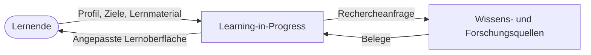
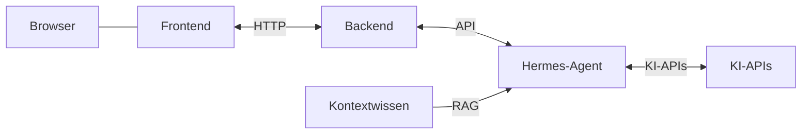

# 3. Kontextabgrenzung

## 3.1 Fachlicher Kontext

Lernmaterial ist Input der Lernenden, zum Beispiel ein Text oder eine Vorlesung. Die Lernenden bringen es zusammen mit Profil und Zielen mit. Learning in Progress lässt das hochgeladene Material unverändert und erzeugt eine neue Darstellung in der Lernoberfläche.

An die Wissens- und Forschungsquellen geht eine Rechercheanfrage, was diesem Profil hilft. Zurück kommen Belege. Das ist der Aufruf aus [6.1 Lernmaterial anpassen](06-laufzeitsicht.md#61-lernmaterial-anpassen).

Input und Output sind aus Sicht des Nachbarn gemeint: Input ist, was der Nachbar von Learning in Progress empfängt, Output ist, was der Nachbar an Learning in Progress übergibt.

| Nachbar | Input | Output |
| --- | --- | --- |
| Lernende | Angepasste Lernoberfläche: Inhalt in anderer Form, Wissen unverändert | Profil, Ziele, Lernmaterial (zum Beispiel Text oder Vorlesung), was bereits funktioniert |
| Wissens- und Forschungsquellen | Rechercheanfrage, was diesem Profil hilft | Belege dafür, welche Form diesem Profil hilft |

Das Lernmaterial steht bei den Lernenden in der Spalte Output, weil sie es an das System übergeben.

## 3.2 Technischer Kontext

Wissens- und Forschungsquellen aus 3.1 und Kontextwissen sind zwei Nachbarn. Die Wissens- und Forschungsquellen sind der fachliche Recherchekanal: Sie empfangen die Rechercheanfrage und liefern Belege, welche Form einem Profil hilft. Kontextwissen ist der Bestand, den Hermes-Agent per RAG liest, zum Beispiel Curricula. Jeder Begriff bezeichnet nur diesen einen Nachbarn.

Hermes-Agent spricht die KI-APIs an und liest Kontextwissen als RAG. Kanäle, Formate und Authentifizierung sind offen.
