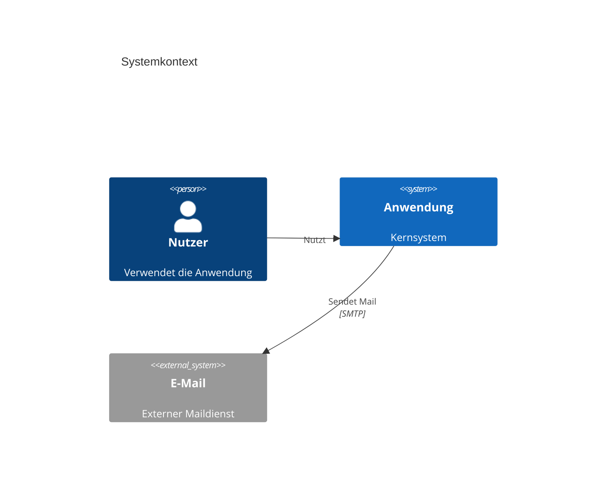
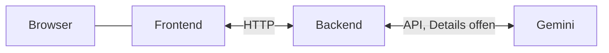

# 3. Kontextabgrenzung

## 3.1 Fachlicher Kontext

| Nachbar | Input | Output |
| --- | --- | --- |
| Lernende | Profil, Ziele, was bereits funktioniert | Angepasste Oberfläche zum Lernen |
| Lernmaterial | Hochgeladene Inhalte, zum Beispiel Text oder Vorlesung | Inhalt in anderer Form, Wissen unverändert |
| Wissens- und Forschungsquellen | — | Belege dafür, welche Form diesem Profil hilft |

## 3.2 Technischer Kontext

Kanäle, Formate und Authentifizierung sind offen.
