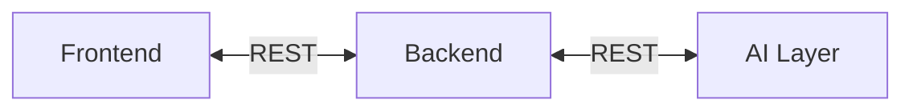
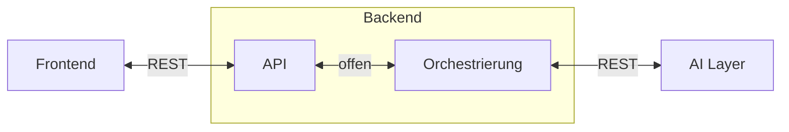
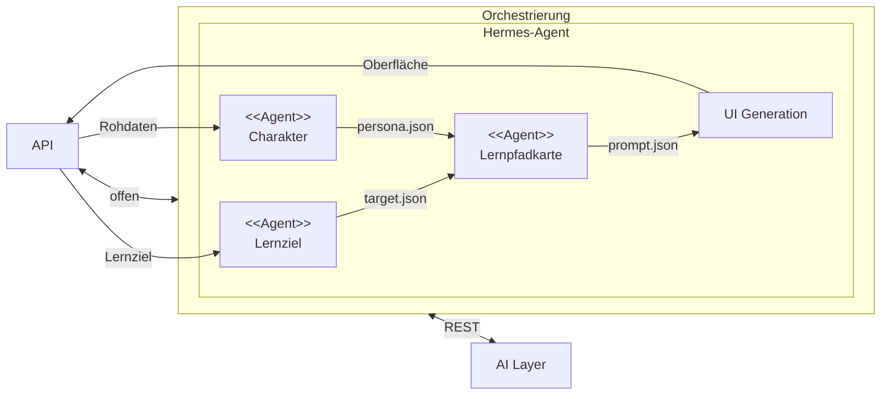

# 5. Bausteinsicht

Die Reihenfolge Lernziel → Charakter / KI-Zwilling → Lernpfadkarte → Generative UI steht in [6.2 Lernpfad erzeugen](06-laufzeitsicht.md#62-lernpfad-erzeugen). Hier stehen die Teile, die diesen Ablauf tragen. Der ältere Ablauf aus der Grundidee in [6.1 Lernmaterial anpassen](06-laufzeitsicht.md#61-lernmaterial-anpassen) ist noch keinen Bausteinen zugeordnet.

## 5.1 Whitebox Gesamtsystem

| Baustein | Verantwortung |
| --- | --- |
| Frontend | Nimmt Lernziel und Rohdaten auf, zeigt die generative UI |
| Backend | API und Orchestrierung von Charakter, Lernpfadkarte und Erzeugung der Oberfläche |
| AI Layer | Baut aus den Rohdaten den Charakter (KI-Zwilling), leitet die Lernpfadkarte ab und generiert die Oberfläche |

Frontend und Backend sowie Backend und AI Layer sind bidirektional über REST verbunden.

## 5.2 Whitebox Backend

Ebene 2 öffnet nur das Backend. Frontend und AI Layer bleiben geschlossene Blackboxes.

| Baustein | Verantwortung |
| --- | --- |
| API | Nimmt Lernziel und Rohdaten vom Frontend an und liefert die Ergebnisse zurück |
| Orchestrierung | Führt Lernziel und Charakter in der Lernpfadkarte zusammen und stößt die Erzeugung der Oberfläche im AI Layer an |

Die externen Schnittstellen sind dieselben wie in 5.1: Frontend und AI Layer über REST. Die Schnittstelle zwischen API und Orchestrierung ist offen. Whiteboxes von Frontend und AI Layer bleiben offen.

## 5.3 Whitebox Orchestrierung

Ebene 3 öffnet nur die Orchestrierung. Ablaufumgebung ist Hermes-Agent. Eine einzige bidirektionale Kante REST führt von der Orchestrierung als Ganzes zum AI Layer, wie in 5.2. Keine eigenen Kanten der inneren Bausteine zum AI Layer. Die API bleibt außen und ist mit der Orchestrierung bidirektional über offen verbunden. Die Prüfung ist kein Baustein (Fokus Lernprozess, [AE-6](09-architekturentscheidungen.md)).

| Baustein | Verantwortung |
| --- | --- |
| Lernziel | Nimmt das Lernziel auf |
| Charakter | Baut aus den Rohdaten den Charakter (KI-Zwilling) |
| Lernpfadkarte | Leitet aus Lernziel und Charakter die Lernpfadkarte ab |
| UI Generation | Lässt aus der Lernpfadkarte die Oberfläche erzeugen und gibt sie an die API zurück |

Lernziel, Charakter und Lernpfadkarte sind `<<Agent>>`. Zur Lernpfadkarte führen `target.json` und `persona.json`, zur UI Generation `prompt.json`. Das Zusammenspiel zur Laufzeit zeigt [6.2 Lernpfad erzeugen](06-laufzeitsicht.md#62-lernpfad-erzeugen).
