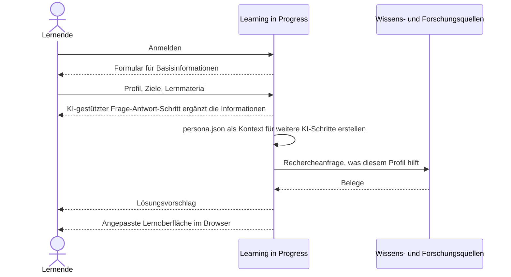
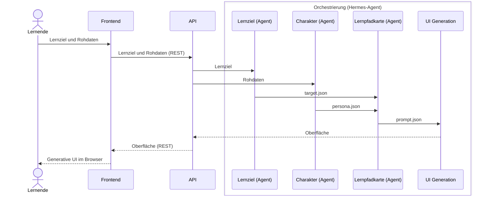

# 6. Laufzeitsicht

## 6.1 Lernmaterial anpassen

Ablauf aus der Grundidee auf Ebene des fachlichen Kontexts ([3.1](03-kontextabgrenzung.md#31-fachlicher-kontext)). Der Ablauf ist noch keinen Bausteinen zugeordnet, Fehlerfälle sind nicht festgelegt. Den Ablauf über die Bausteine aus Kapitel 5 zeigt [6.2 Lernpfad erzeugen](#62-lernpfad-erzeugen).

1. Die lernende Person meldet sich an. Das System zeigt ein Formular für Basisinformationen.
2. Die lernende Person übergibt Profil, Ziele und Lernmaterial, zum Beispiel einen Text oder eine Vorlesung. Ein KI-gestützter Frage-Antwort-Schritt ergänzt diese Informationen.
3. Learning in Progress ruft sich selbst auf und erstellt eine `persona.json` als Kontext für weitere KI-Schritte.
4. Das System stellt eine Rechercheanfrage an die Wissens- und Forschungsquellen, was diesem Profil hilft. Zurück kommen Belege.
5. Das System schlägt eine Lösung vor.
6. Das System baut die angepasste Lernoberfläche im Browser. Das hochgeladene Lernmaterial bleibt unverändert, nur die Darstellung ist neu.

Offen aus der Ideensammlung, noch ohne eigenes Szenario: Mehrere Lösungen laufen im Hintergrund mit dem digitalen Zwilling. Konkrete Formen der Oberfläche, etwa zerlegte Texte, ein Chat über eine Videovorlesung oder eine Browser-Erweiterung, sind Beispiele.

## 6.2 Lernpfad erzeugen

Ablauf Lernziel → Charakter / KI-Zwilling → Lernpfadkarte → Generative UI über die Bausteine aus [5.3 Whitebox Orchestrierung](05-bausteinsicht.md#53-whitebox-orchestrierung). Die Prüfung ist nicht Teil des Ablaufs ([AE-6](09-architekturentscheidungen.md)).

1. Die lernende Person gibt im Frontend ihr Lernziel und ihre Rohdaten ein (Profil, Ziele, Lernmaterial aus [3.1](03-kontextabgrenzung.md#31-fachlicher-kontext)). Das Frontend schickt beides per REST an die API des Backends.
2. Die API gibt das Lernziel an den Agenten Lernziel und die Rohdaten an den Agenten Charakter.
3. Der Agent Lernziel liefert `target.json` an die Lernpfadkarte.
4. Der Agent Charakter baut aus den Rohdaten den Charakter (KI-Zwilling) und liefert `persona.json` an die Lernpfadkarte.
5. Der Agent Lernpfadkarte leitet aus `target.json` und `persona.json` die Lernpfadkarte ab und übergibt `prompt.json` an die UI Generation.
6. Die UI Generation lässt die Oberfläche erzeugen und gibt sie an die API zurück.
7. Die API liefert die Oberfläche per REST an das Frontend, das sie als generative UI im Browser zeigt.

Die Reihenfolge der Schritte 3 und 4 zueinander ist offen. Alle KI-Aufrufe der Agenten laufen über die eine REST-Verbindung der Orchestrierung zum AI Layer ([5.2](05-bausteinsicht.md#52-whitebox-backend)). Der AI Layer ist deshalb nicht als eigener Teilnehmer je Agent eingezeichnet. Offen sind außerdem:

- welcher Agent die Rechercheanfrage an die Wissens- und Forschungsquellen stellt und wo die Belege in den Ablauf eingehen,
- an welcher Stelle Hermes-Agent Kontextwissen per RAG liest ([3.2](03-kontextabgrenzung.md#32-technischer-kontext)),
- die Schnittstelle zwischen API und Orchestrierung sowie die Fehlerfälle.
