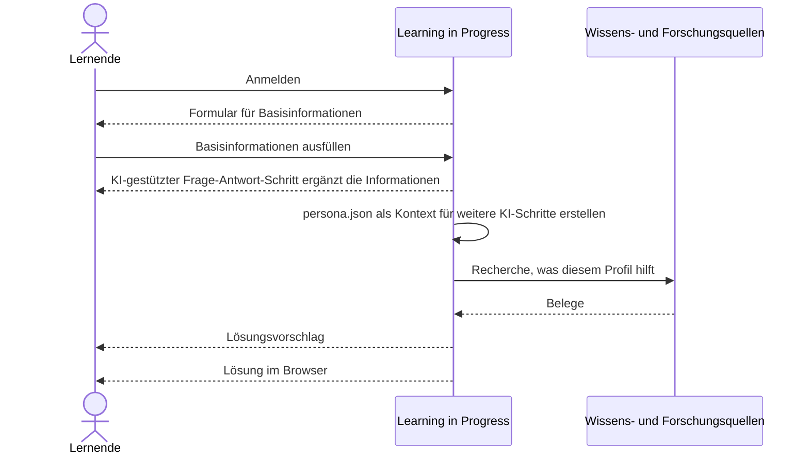

# 6. Laufzeitsicht

## 6.1 Lernmaterial anpassen

Ablauf aus der Grundidee. Beteiligte Bausteine und Fehlerfälle sind noch nicht festgelegt.

1. Die lernende Person meldet sich an. Das System zeigt ein Formular für Basisinformationen.
2. Die lernende Person füllt die Basisinformationen aus. Ein KI-gestützter Frage-Antwort-Schritt ergänzt diese Informationen.
3. Learning in Progress ruft sich selbst auf und erstellt eine `persona.json` als Kontext für weitere KI-Schritte.
4. Das System recherchiert, was diesem Profil nachweislich hilft.
5. Das System schlägt eine Lösung vor.
6. Das System baut diese Lösung im Browser.

Offen aus der Ideensammlung, noch ohne eigenes Szenario: Mehrere Lösungen laufen im Hintergrund mit dem digitalen Zwilling. Konkrete Formen der Oberfläche, etwa zerlegte Texte, ein Chat über eine Videovorlesung oder eine Browser-Erweiterung, sind Beispiele.
