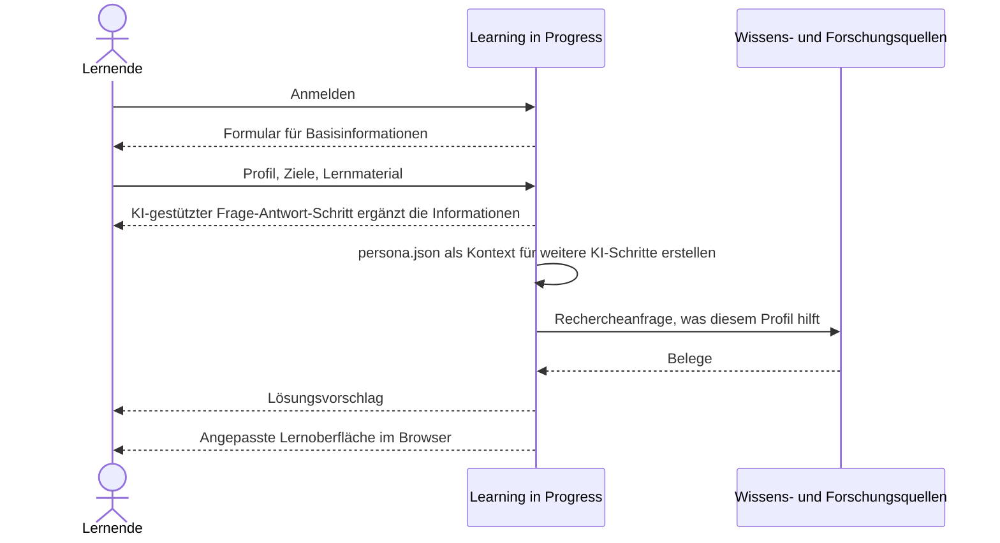
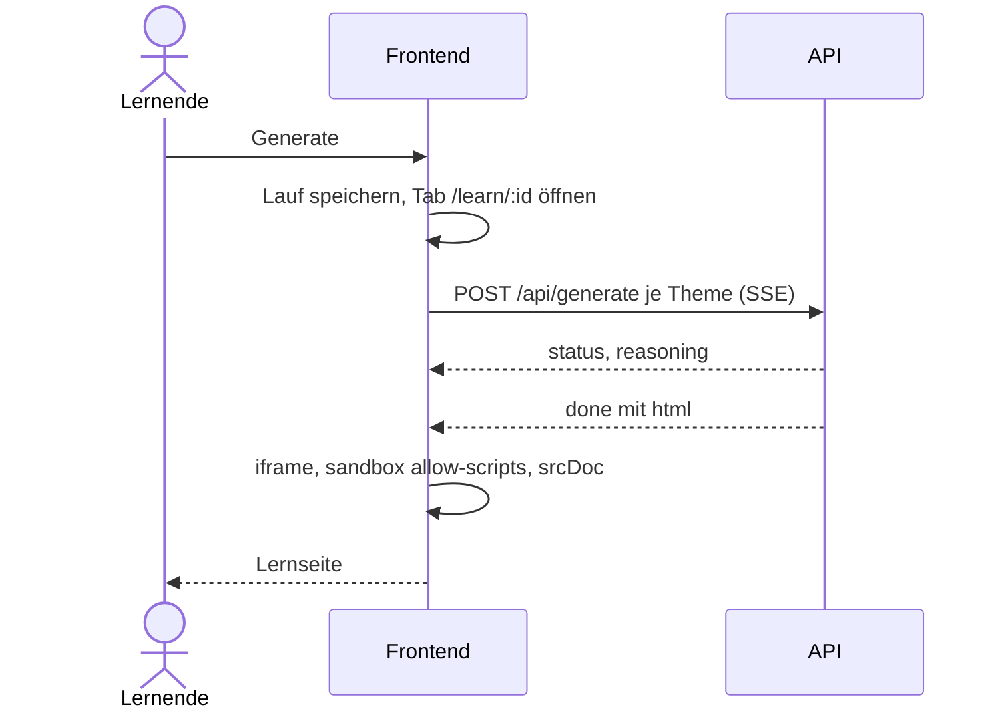
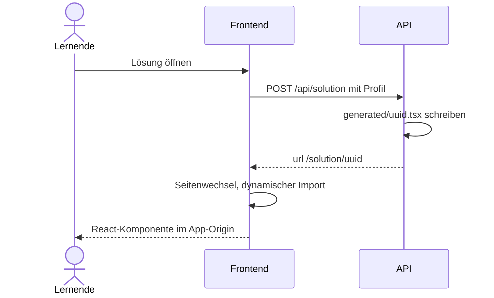

# 6. Laufzeitsicht

## 6.1 Lernmaterial anpassen

Ablauf aus der Grundidee auf Ebene des fachlichen Kontexts ([3.1](03-kontextabgrenzung.md#31-fachlicher-kontext)). Der Ablauf ist noch keinen Bausteinen zugeordnet, Fehlerfälle sind nicht festgelegt. Den Ablauf über die Bausteine aus Kapitel 5 zeigt [6.2 Lernpfad erzeugen](#62-lernpfad-erzeugen).

1. Die lernende Person meldet sich an. Das System zeigt ein Formular für Basisinformationen.
2. Die lernende Person übergibt Profil, Ziele und Lernmaterial, zum Beispiel einen Text oder eine Vorlesung. Ein KI-gestützter Frage-Antwort-Schritt ergänzt diese Informationen.
3. Learning in Progress ruft sich selbst auf und erstellt eine `persona.json` als Kontext für weitere KI-Schritte.
4. Das System stellt eine Rechercheanfrage an die Wissens- und Forschungsquellen, was diesem Profil hilft. Zurück kommen Belege.
5. Das System schlägt eine Lösung vor.
6. Das System baut die angepasste Lernoberfläche im Browser. Das hochgeladene Lernmaterial bleibt unverändert, nur die Darstellung ist neu.

Offen aus der Ideensammlung, noch ohne eigenes Szenario: Mehrere Lösungen laufen im Hintergrund mit dem digitalen Zwilling. Konkrete Formen der Oberfläche, etwa zerlegte Texte, ein Chat über eine Videovorlesung oder eine Browser-Erweiterung, sind Beispiele.

## 6.2 Auslieferung

Aktuelle Auslieferung der generativen UI. Sie ersetzt die eine Rückgabe `ui-artefact.json` aus [6.2](#62-lernpfad-erzeugen). Bausteine: [5.4 Generative UI](05-bausteinsicht.md#54-generative-ui).

### 6.3.1 HTML-Lernseite

Führender Pfad nach „Mein Werkzeug bauen“ und aus dem Playground.

1. **Erzeugung.** Das Frontend schickt Profil, Antworten, Material und Theme an `POST /api/generate`. Der Aufruf ist ein Server-Sent-Event-Stream. Hermes schreibt eine HTML-Seite. Der Server setzt ein Content-Security-Policy-Meta-Tag an den Anfang des Dokuments und liefert `{ html }` im Ereignis `done`.
2. **Auslieferung.** `LearningPage` zeigt das HTML als `srcDoc` in einem `iframe`. Lauf und fertige Seiten liegen in `localStorage`, damit ein Neuladen des Tabs keine neue Generierung startet.
3. **Route.** `/learn/:id`, geöffnet in einem neuen Tab.
4. **Sicherheitsgrenze.** Das `iframe` hat `sandbox="allow-scripts"` und nicht `allow-same-origin`. Skripte laufen, erreichen aber nicht die Anwendung, ihre Cookies oder ihren Speicher. Die CSP erlaubt Inline-Skripte, Inline-Styles, Daten-URLs für Schriften sowie Daten- und Blob-URLs für Bilder und Medien. Alles andere, auch Formularziele und Netzabrufe, ist verboten.

### 6.3.2 Solution Page

Zweiter Pfad über „Magische Seite“.

1. **Erzeugung.** Das Frontend schickt das Profil an `POST /api/solution`. Hermes schreibt `client/src/features/application/generated/{uuid}.tsx`. Die Antwort ist `{ url }`, die URL ist `/solution/{uuid}`.
2. **Auslieferung.** Der Browser wechselt vollständig auf diese URL. `SolutionRoute` lädt die Datei über `import.meta.glob('./generated/*.tsx')`. Fehlt sie auf diesem Prozess, zeigt die Route, dass die Seite nicht mehr existiert.
3. **Route.** `/solution/:uuid`.
4. **Sicherheitsgrenze.** Die Komponente rendert im Origin der Anwendung, innerhalb von `.application-page`, ohne `iframe` und ohne Sandbox. Sie ist Anwendungscode. Die Datei gibt es nur auf dem Server, der sie geschrieben hat.
